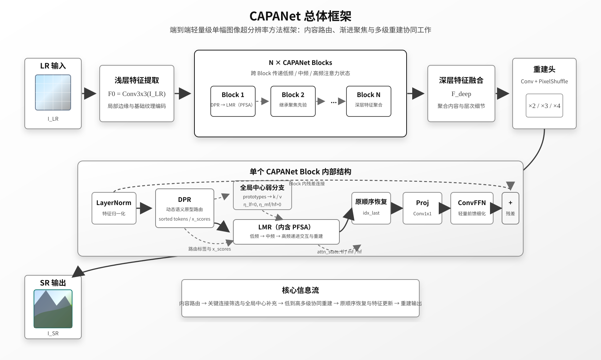

# 毕业论文正文

本目录用于撰写和保存硕士毕业论文。现有开题报告位于 [proposal/开题报告.md](../proposal/开题报告.md)，研究支撑资料可从 [项目资料索引](../README.md) 查找。

## 写作文件

- 使用 Markdown 时，可在本目录创建正文文件，或在 `chapters/` 下按章节保存。
- 使用 LaTeX 时，在本目录保存 `main.tex`、参考文献 `.bib` 文件和学校模板，章节文件放在 `chapters/`。编译中间产物可输出到 `build/`。
- 使用 Word 时，将正文 `.docx` 和最终导出的 PDF 放在本目录。

以上是存放约定，按实际采用的学校模板与写作格式创建文件即可。

## 引用共用配图

从本目录内的 Markdown 正文引用已有结构图：

```markdown

```

若正文位于 `chapters/`，相对路径应改为 `../../assets/figures/…`。可编辑图源位于 [Draw.io 图源目录](../assets/figures/drawio/)，配图使用说明见 [配图目录说明](../assets/figures/README.md)。

LaTeX 正文按编译引擎要求使用 PDF 或 PNG。最终论文 PDF 与正式配图可纳入 Git，编译中间文件由根目录 `.gitignore` 忽略。
